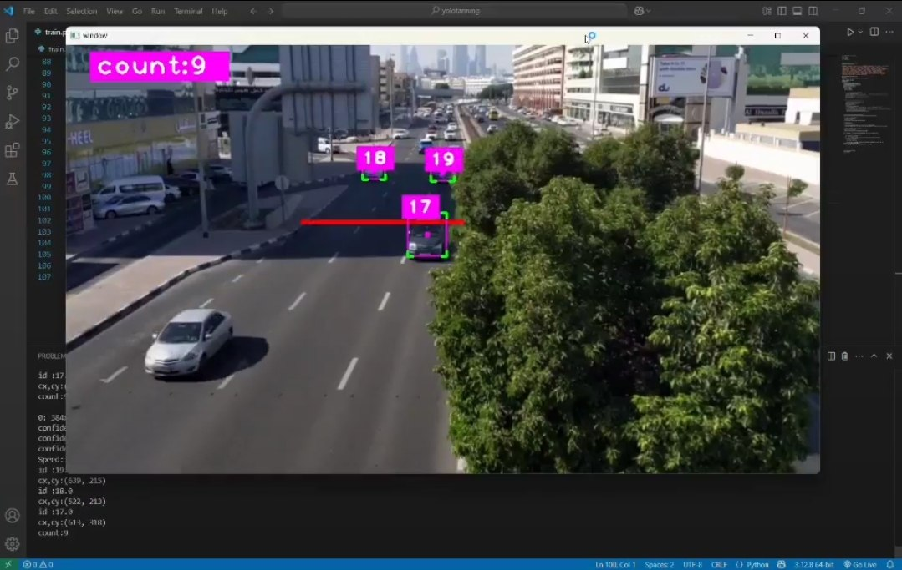

# Real-Time Vehicle Counting — YOLOv8 + OpenCV 🚦🚗

Simple, fast vehicle counting that uses YOLOv8 for detection and OpenCV for video processing. A custom binary mask makes sure only vehicles on the road are counted (parked/off-road ignored).



What it does
- Detects vehicles in video frames and tracks them across frames.
- Counts vehicles that cross a counting line or meet the configured counting logic.
- Ignores detections outside a user-defined road mask (reduces false counts).

Tech used
- Python 3.8+
- YOLOv8 (Ultralytics) — object detection
- OpenCV — video I/O, drawing, mask handling
- NumPy, Pandas — data handling and export (CSV)
- PyTorch (optional GPU acceleration)
- Optional: RTSP/webcam input support

Where it’s useful
- Traffic signal optimization and adaptive control
- Urban planning and traffic pattern analysis
- Real-time monitoring for highways, intersections, or parking enforcement

Quickstart
1. Install:
   ```bash
   pip install -r requirements.txt
   ```
2. Add demo image and mask:
   - Save your demo frame as `vehicle_counting_output.jpg` (used above).
   - Add a binary mask as `assets/mask.png` (white = count area, black = ignore).
3. Run:
   ```bash
   python scripts/vehicle_count.py --source path/to/video.mp4 --weights yolov8n.pt --mask assets/mask.png --output results/
   ```

Notes
- For CPU use lightweight models (yolov8n/yolov8s). Use GPU + CUDA for higher throughput and larger models.
- Ensure mask resolution matches the processed frame size (or let the script resize it with nearest-neighbor).
